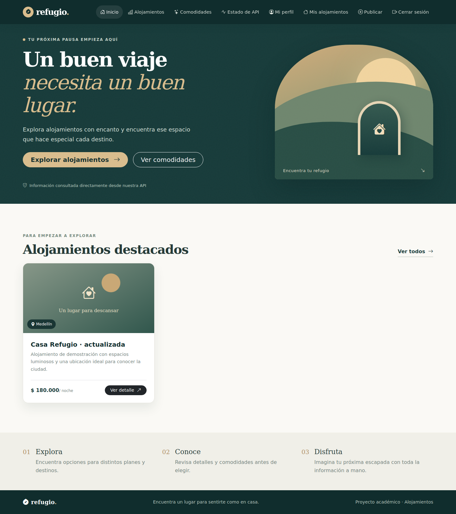

# Refugio — Frontend Alojamientos

Aplicación web académica SPA para consultar y publicar alojamientos, administrar sus comodidades y controlar el acceso mediante autenticación JWT, roles y propiedad de los recursos.

## Objetivo

Integrar los tres tutoriales del curso en una interfaz modular, responsive y conectada a una API REST Flask con MySQL. Los visitantes consultan el catálogo; los usuarios registrados gestionan sus publicaciones; los administradores gestionan recursos ajenos, consultan usuarios y crean comodidades.

## Tecnologías y requisitos

| Capa | Herramientas |
| --- | --- |
| Interfaz | HTML5, CSS3, JavaScript Vanilla y módulos ES6 |
| Desarrollo y compilación | Vite 7, npm, Node.js 22.12+ |
| Componentes visuales | Bootstrap 5.3, Bootstrap Icons |
| Navegación y HTTP | History API, Fetch, JSON |
| Autenticación | JWT Bearer, sessionStorage |
| Pruebas | node:test y node:assert, 37 casos |
| Backend independiente | Python 3.11+, Flask, SQLAlchemy, Alembic, MySQL 8 o entorno XAMPP compatible |

La aplicación necesita el backend actualizado con las migraciones 001, 002 y 003. La copia anterior del backend solo tenía autenticación. La entrega incluye por separado el complemento `api-alojamientos-completado.zip`, que completa las rutas exigidas por los tres tutoriales. Su publicación e instalación se explican en [la guía del backend](docs/backend.md).

## Instalación rápida

Desde Git Bash, PowerShell o una terminal equivalente:

```bash
git clone https://github.com/Camolo28/frontend-alojamientos.git
cd frontend-alojamientos
npm install
```

Copia `.env.example` como `.env`. En Git Bash:

```bash
cp .env.example .env
```

En PowerShell puedes usar `Copy-Item .env.example .env`. El contenido es:

```dotenv
VITE_API_URL=http://localhost:5000
```

Esta variable es pública y solo indica la URL de la API. Los secretos de Flask y las credenciales de MySQL pertenecen exclusivamente al `.env` del backend. Reinicia Vite al modificar la configuración.

Inicia MySQL, aplica las migraciones del backend e inicia Flask. Luego ejecuta:

```bash
npm run dev
```

Abre http://localhost:5173. Mantén una terminal para Flask y otra para Vite. Antes de publicar esta entrega, `main` debe integrarse según [publicación y entrega](docs/entrega.md); el clon de la rama principal anterior solo contenía el README inicial.

## Comandos

| Comando | Resultado |
| --- | --- |
| `npm install` | Instala las dependencias del proyecto |
| `npm ci` | Instalación reproducible desde package-lock.json |
| `npm test` | Ejecuta las 37 pruebas de los tres sprints |
| `npm run dev` | Servidor de desarrollo, puerto 5173 |
| `npm run build` | Genera la versión compilada en dist |
| `npm run preview` | Sirve la compilación en el puerto 4173 |

Ejecuta build antes de preview. El backend debe permitir tanto `http://localhost:5173` como `http://localhost:4173` en CORS para probar ambos modos. Si el puerto está ocupado, cierra la instancia anterior. El desarrollo usa puerto estricto 5173.

## Estructura

```text
frontend-alojamientos/
  index.html
  package.json
  package-lock.json
  vite.config.js
  .env.example
  .gitignore
  src/
    css/main.css
    js/
      main.js
      api/          Fetch, consultas públicas y mutaciones
      state/        Sesión de la pestaña
      router/       Rutas, navegación y permisos
      components/   Navbar, Footer, tarjetas y formularios
      pages/        Vistas públicas y protegidas
      utils/        Validaciones, normalización y presentación
  tests/
    frontend.test.js
    auth.test.js
    gestion.test.js
  docs/
    sprint-1.md
    sprint-2.md
    sprint-3.md
    arquitectura.md
    backend.md
    verificacion.md
    entrega.md
    evidencias/
```

## Módulos

**Sprint 1.** Navegación SPA, catálogo público, filtro por título o ciudad, detalle con comodidades, estado de API, estados de carga/vacío/error y 404.

**Sprint 2.** Registro, login, perfil de lectura, usuarios administrativos de lectura, Navbar por rol, cierre local, sesión persistente durante la pestaña y manejo de 401/403.

**Sprint 3.** Publicación, listado propio, edición, eliminación confirmada, asociación completa de comodidades, creación administrativa de comodidades y retorno a una ruta protegida después del login.

## Rutas

| Ruta | Vista | Acceso |
| --- | --- | --- |
| `/` | Inicio | Público |
| `/alojamientos` | Catálogo y filtro | Público |
| `/alojamientos/:id` | Detalle y comodidades | Público |
| `/comodidades` | Catálogo de comodidades | Público |
| `/estado-api` | Estado del backend | Público |
| `/registro` | Crear cuenta | Público |
| `/login` | Iniciar sesión | Público |
| `/perfil` | Perfil de lectura | Autenticado |
| `/mis-alojamientos` | Publicaciones propias | Autenticado |
| `/alojamientos/nuevo` | Publicar | Autenticado |
| `/alojamientos/:id/editar` | Editar, asociar y eliminar | Propietario o administrador |
| `/admin/usuarios` | Listado de usuarios | Administrador |
| `/admin/comodidades/nueva` | Crear comodidad | Administrador |
| `/no-autorizado` | Acceso restringido | Mensaje informativo |
| Cualquier ruta desconocida | 404 de la SPA | Público |

## Endpoints consumidos

| Método | Endpoint | Cuerpo / respuesta relevante |
| --- | --- | --- |
| GET | `/health` | Estado del servicio |
| POST | `/api/v1/usuarios/registro` | nombre opcional, correo, contrasena; devuelve usuario, 201 |
| POST | `/api/v1/usuarios/login` | correo, contrasena; devuelve access_token |
| GET | `/api/v1/usuarios/perfil` | Usuario autenticado con perfil.nombre |
| GET | `/api/v1/admin/usuarios` | Objeto con arreglo usuarios |
| GET | `/api/v1/alojamientos` | Objeto con arreglo alojamientos |
| GET | `/api/v1/alojamientos/:id` | Objeto de alojamiento y comodidades |
| POST | `/api/v1/alojamientos` | titulo, descripcion, ciudad, precio_por_noche; 201 |
| PATCH | `/api/v1/alojamientos/:id` | Campos del alojamiento; 200 |
| DELETE | `/api/v1/alojamientos/:id` | Respuesta vacía 204 |
| GET | `/api/v1/comodidades` | Objeto con arreglo comodidades |
| POST | `/api/v1/comodidades` | nombre; 201, duplicado 409 |
| PATCH | `/api/v1/alojamientos/:id/comodidades` | comodidades_ids completo, permite [] |

Los endpoints privados reciben `Authorization: Bearer <token>`. El propietario se toma de `usuario_id` en la respuesta y lo determina el backend durante la creación. Se conservan formatos de colección compatibles del Sprint 1.

## Roles y sesión

| Operación | Visitante | Usuario | Administrador |
| --- | --- | --- | --- |
| Consultar catálogo, detalle y comodidades | Sí | Sí | Sí |
| Publicar | Login requerido | Sí | Sí |
| Ver publicaciones propias | Login requerido | Sí | Sí, las propias |
| Editar, eliminar y asociar comodidades | Login requerido | Sus alojamientos | Cualquier alojamiento |
| Crear comodidad / listar usuarios | Login requerido | 403 | Sí |

La clave `alojamientos.sesion` en sessionStorage contiene el token y los datos básicos del usuario. Login consulta el perfil antes de guardarlos. Al cerrar sesión se borra esa clave. Un 401 de la sesión vigente la elimina y redibuja el login. Un 403 conserva la sesión y presenta el error. Las restricciones se aplican también en Flask.

## Validaciones y errores

Registro exige correo válido y contraseña de 6 a 128 caracteres; la confirmación se compara localmente. Alojamiento exige título (máximo 200), descripción (máximo 10000), ciudad (máximo 100) y precio entre 0,01 y 9.999.999.999,99 con dos decimales. Comodidad exige nombre de 1 a 100 caracteres. La API aplica las reglas definitivas.

El cliente procesa errores 400, 401, 403, 404 y 409, respuestas JSON inválidas y problemas de conexión. Los formularios deshabilitan sus botones mientras guardan. Datos y comodidades se guardan por separado y muestran su resultado independiente. Eliminar exige confirmación.

## Evidencias y verificación

[Informe de verificación y galería](docs/verificacion.md). Las capturas se obtuvieron en navegador con Flask y MySQL 8.0.36 reales y datos sintéticos. El informe distingue la prueba ejecutada en este entorno de la instalación y publicación pendientes en el equipo del estudiante.



Resultados comprobados: 37 pruebas de frontend aprobadas, build correcto, 16 pruebas de backend aprobadas, migraciones hasta 003 y flujo real de registro, login, perfil, CRUD, asociaciones y autorización. Las pruebas unitarias usan mocks para aislar servicios; las evidencias de integración se obtuvieron contra la API real. Los archivos originales de los tutoriales no se recibieron, por lo que se cubre el enunciado sin afirmar equivalencia textual de sus casos de prueba.

## Documentación por etapa

- [Sprint 1](docs/sprint-1.md)
- [Sprint 2](docs/sprint-2.md)
- [Sprint 3](docs/sprint-3.md)
- [Arquitectura](docs/arquitectura.md)
- [Backend y MySQL](docs/backend.md)
- [Pruebas y evidencias](docs/verificacion.md)
- [Integración de ramas y entrega final](docs/entrega.md)

## Estado de publicación

El historial remoto se clonó y revisó. Los Sprints 1, 2 y 3 están en sus ramas y PR #1, #3 y #5. La escritura autenticada en GitHub no estaba disponible durante la preparación: integrar main, publicar los cambios finales y verificar un clon de ese main final son pasos pendientes que debe ejecutar el titular de la cuenta. La copia limpia del artefacto final se instala y compila siguiendo esta documentación. El ZIP final publicado por el estudiante debe generarse desde main después de completar esos pasos.
