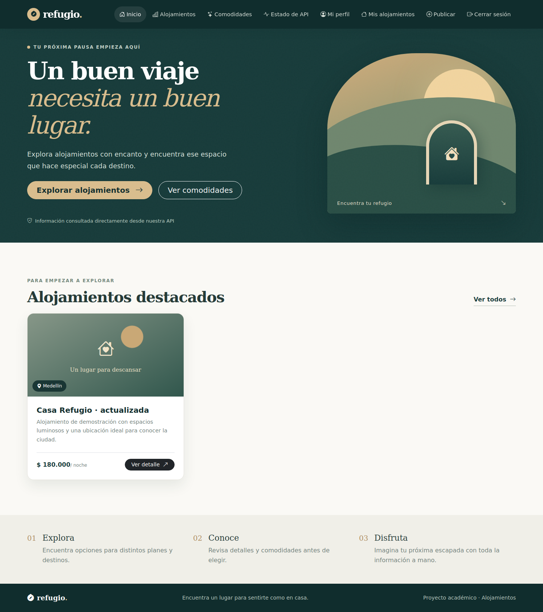
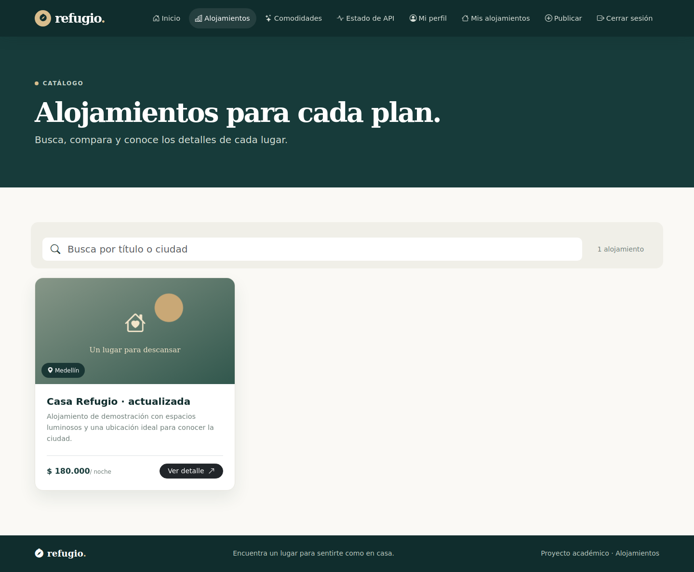
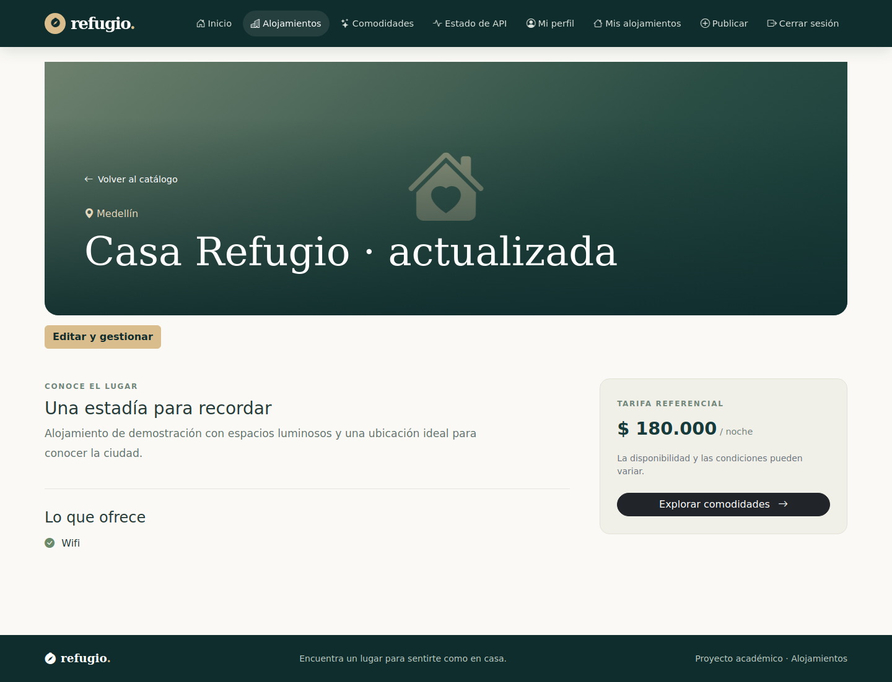
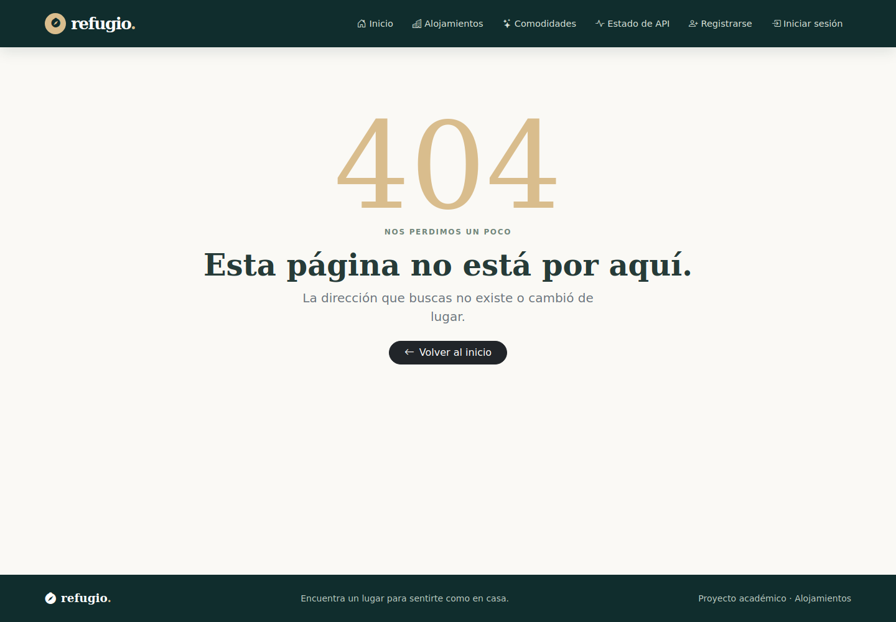
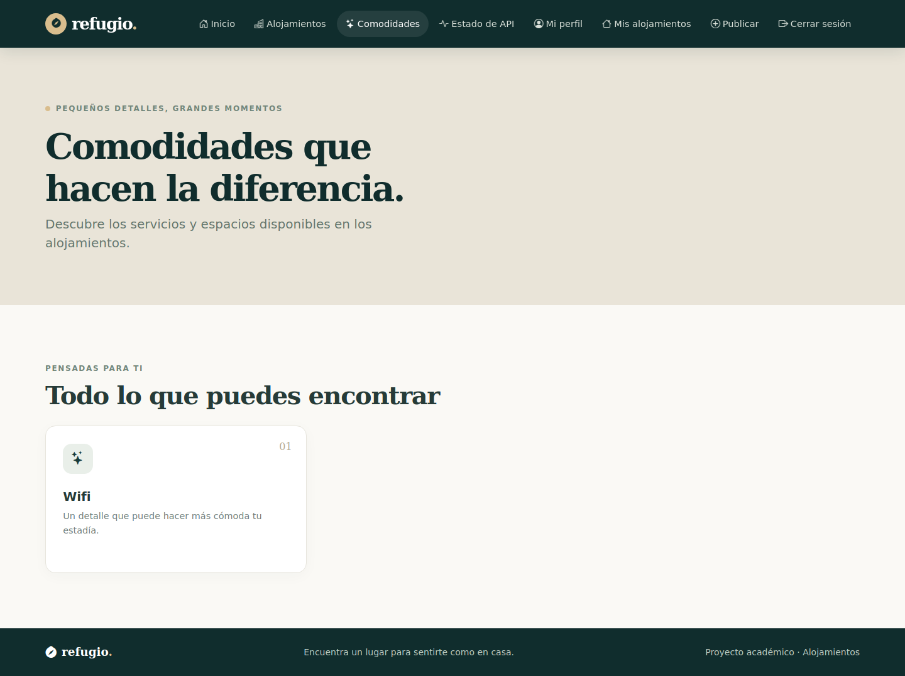
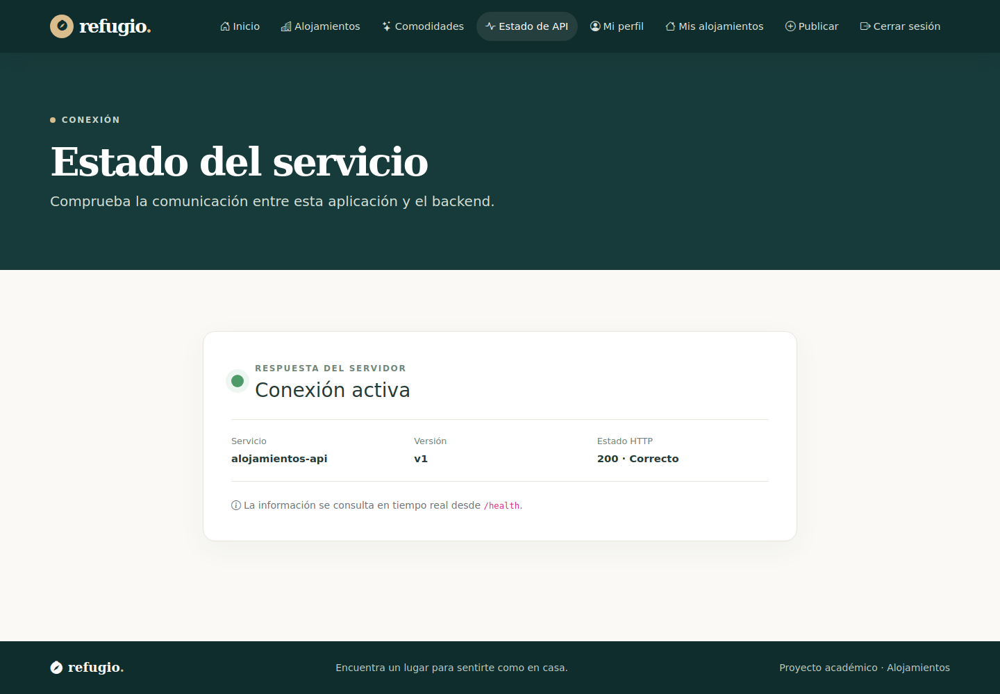

# Sprint 1 — SPA pública

## Objetivo y resultado

Construir la SPA Vanilla con Vite configurado manualmente, Bootstrap e integración Fetch. Las vistas públicas consultan health, alojamientos, detalle y comodidades. El catálogo filtra por título o ciudad. El router usa pushState y popstate y presenta la página 404 para rutas desconocidas.

## Archivos

`index.html`, `main.js`, `router/routes.js`, `router/router.js`, `api/client.js`, `api/alojamientos.js`, las páginas públicas y los componentes Navbar, Footer, Feedback y AlojamientoCard. `http.js` centraliza actualmente el cliente y `client.js` reexporta las funciones para conservar sus consumidores.

## Verificación

Nueve pruebas unitarias cubren escape HTML, colecciones, formato monetario, filtros y reconocimiento de rutas. En la integración final se comprobó el catálogo con datos persistidos, detalle y comodidades. Se corrigió la altura de la tarjeta para que su precio y enlace queden visibles, y se eliminó una animación de colapso ejecutada al crear la Navbar.

## Historial

Rama `feat/sprint-01-spa-publica`. PR [#1](https://github.com/Camolo28/frontend-alojamientos/pull/1). Commit de implementación `a61f092`. Las rutas de catálogo faltaban en el backend original y se completaron en la preparación final del backend.

## Evidencias

