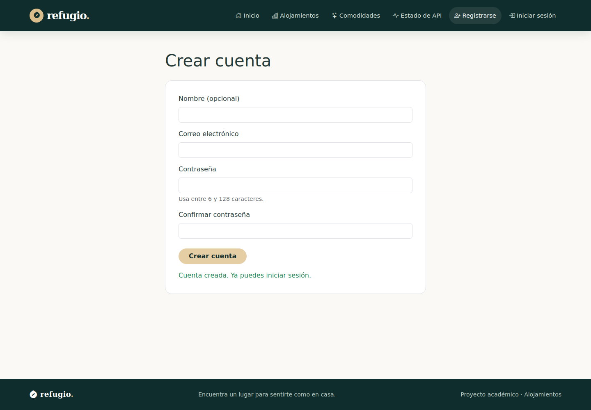
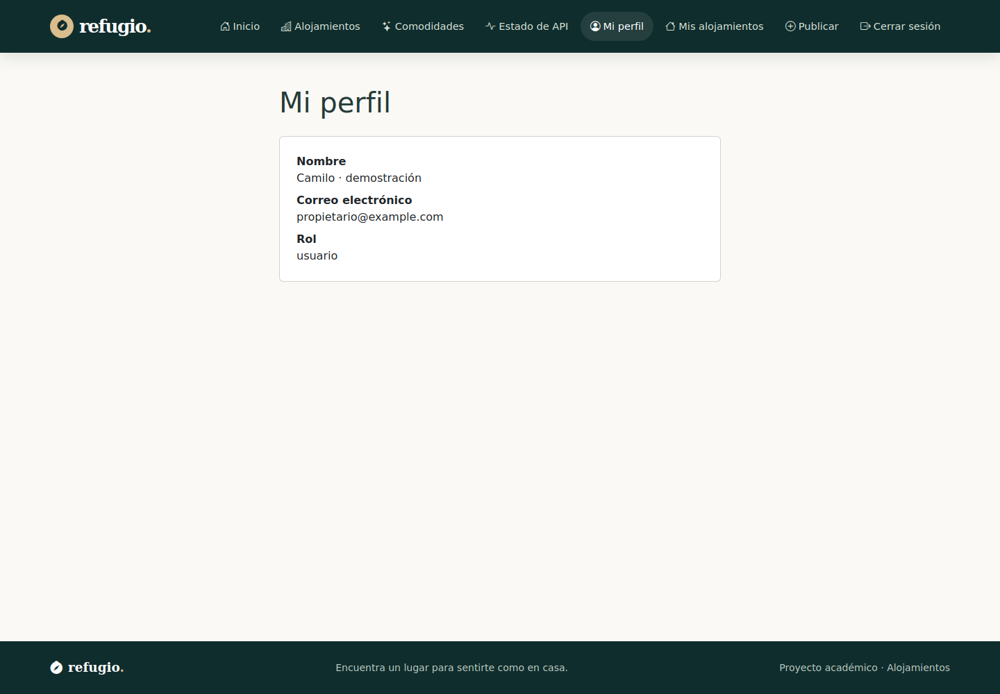
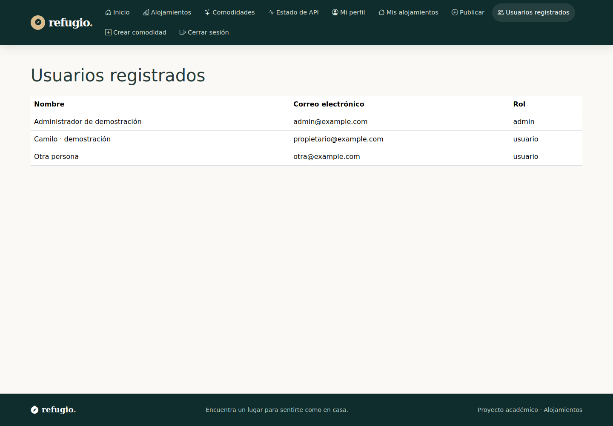
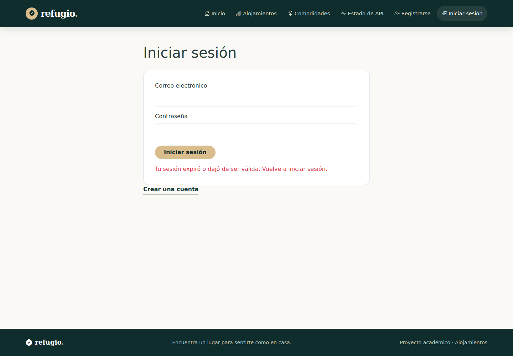
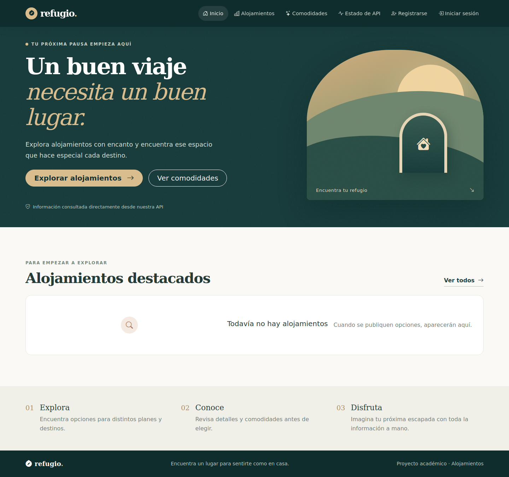

# Sprint 2 — Autenticación y autorización

## Flujo

Registro envía nombre, correo y contrasena. Login obtiene access_token y consulta perfil con Bearer antes de persistir sesión. Perfil y administración son vistas de lectura. El router restringe rutas privadas y rol administrador. La Navbar cambia sus enlaces según sesión y rol.

El cierre de sesión elimina `alojamientos.sesion` y vuelve a Inicio. Un 401 del token vigente elimina la sesión, redirige al login y actualiza la barra. Un error recibido de una petición con token anterior no borra una sesión nueva. Un 403 muestra el rechazo y conserva la sesión.

## Archivos

`state/sesion.js`, `api/http.js`, `api/auth.api.js`, `utils/validaciones.js`, `router/permisos.js`, RegistroPage, LoginPage, PerfilPage, AdminUsuariosPage y NoAutorizadoPage.

## Resultado y pruebas

Se agregaron 14 casos a los nueve anteriores. Cubren almacenamiento, borrado y corrupción de sesión, Navbar, validaciones, acceso, contratos HTTP, inicio parcial fallido y manejo de errores. La integración real comprobó registro 201, login/perfil 200, administración por rol, cierre de sesión y rechazo 401 de token inválido.

## Historial

Rama `feat/sprint-02-autenticacion`. PR [#3](https://github.com/Camolo28/frontend-alojamientos/pull/3). Commit `67f9935`. La rama partió de la del Sprint 1 para respetar su revisión pendiente.

## Evidencias

