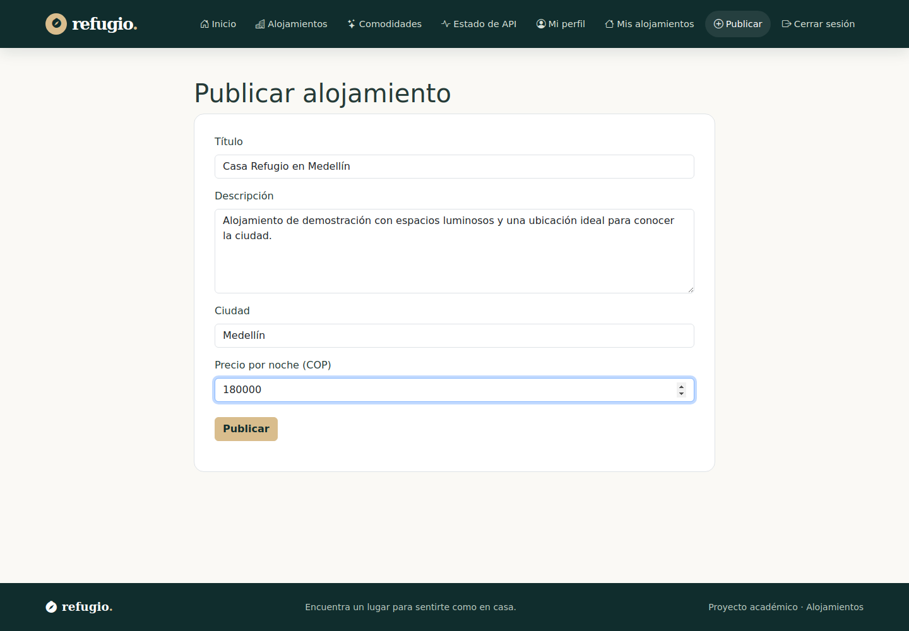
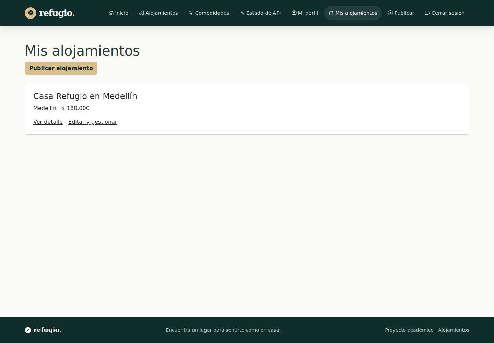
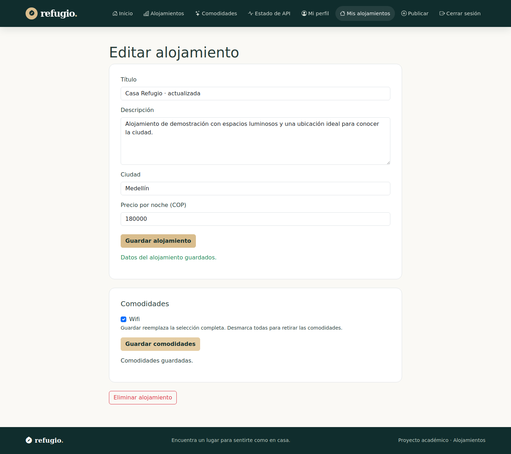
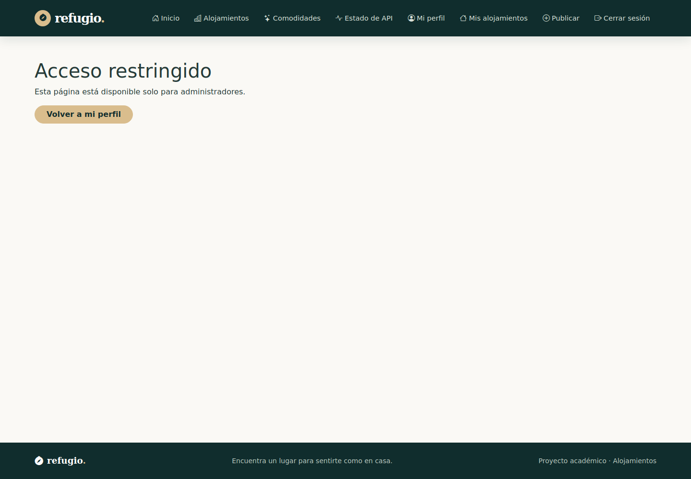
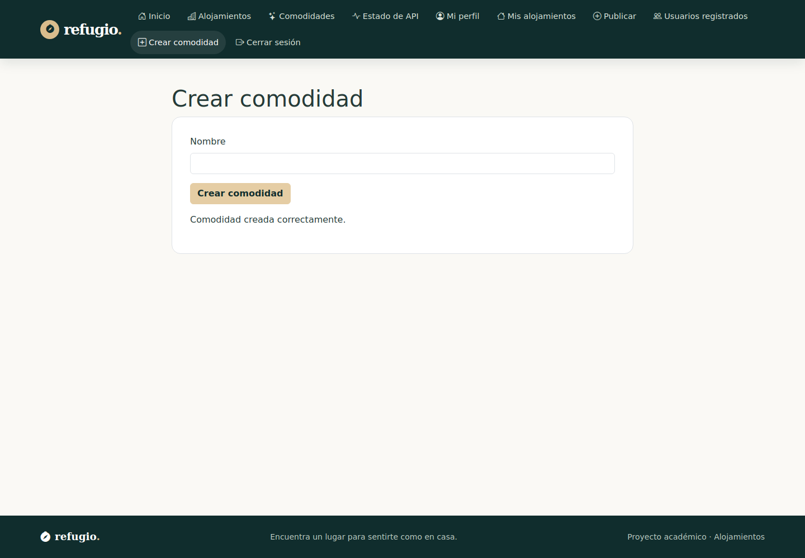
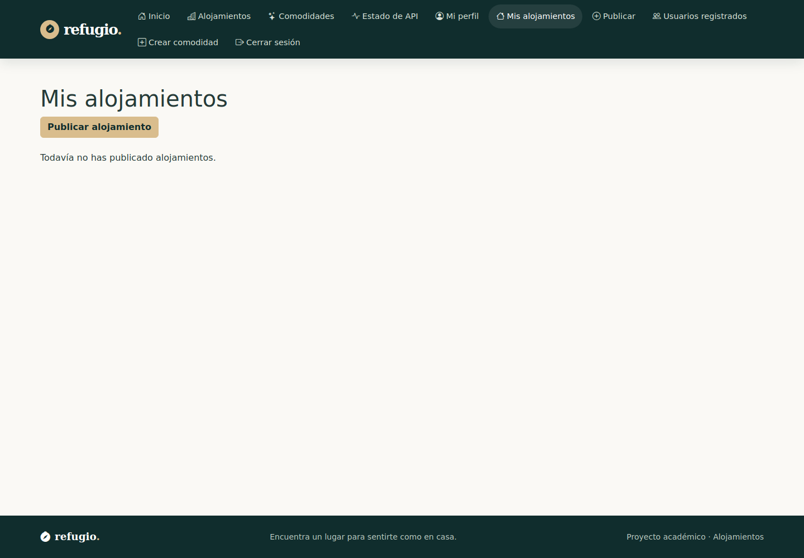

# Sprint 3 — Alojamientos y comodidades

## Funcionalidades

El formulario reutilizable captura título, descripción, ciudad y precio. Mis alojamientos obtiene el catálogo público y filtra por usuario_id. La edición consulta el recurso antes de mostrar controles y exige propietario o admin. Los datos se actualizan con PATCH. La relación de comodidades se reemplaza enviando comodidades_ids completo, incluido el arreglo vacío. Eliminar requiere confirmación y acepta 204 sin intentar leer JSON.

Crear comodidad requiere admin. El nombre duplicado recibe 409. Las rutas específicas de creación y edición se reconocen antes de la ruta genérica de detalle. El parámetro next del login admite solo rutas locales conocidas.

## Archivos

`api/alojamientos.api.js`, `api/comodidades.api.js`, `utils/gestion.js`, `components/AlojamientoForm.js`, `components/ComodidadesSelector.js` y las cuatro páginas nuevas de gestión.

## Permisos y persistencia

La API toma el propietario del JWT y valida propiedad o rol para PATCH, DELETE y asociaciones. Se verificó que una segunda cuenta recibe 403 en las tres mutaciones y conserva acceso al perfil. Admin pudo editar un recurso ajeno. La selección fallida por ID inexistente conserva las relaciones previas. Eliminar conserva el catálogo global de comodidades.

## Resultado

Catorce pruebas adicionales elevan el total a 37. La preparación inicial empleó respuestas simuladas para desarrollar la interfaz; la entrega final agrega la verificación con Flask y MySQL reales y migraciones 001 a 003.

## Historial

Rama `feat/sprint-03-crud-comodidades`. PR [#5](https://github.com/Camolo28/frontend-alojamientos/pull/5). Commit `40b3ee0`.

## Evidencias

