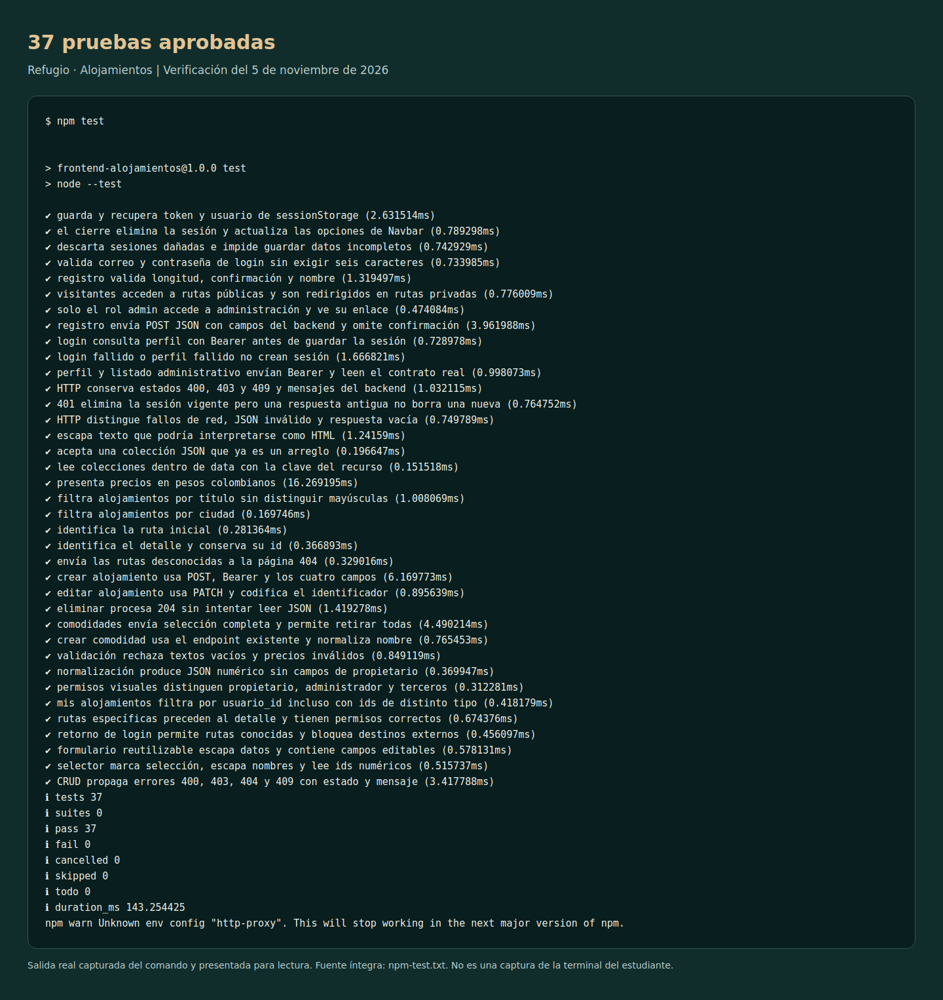
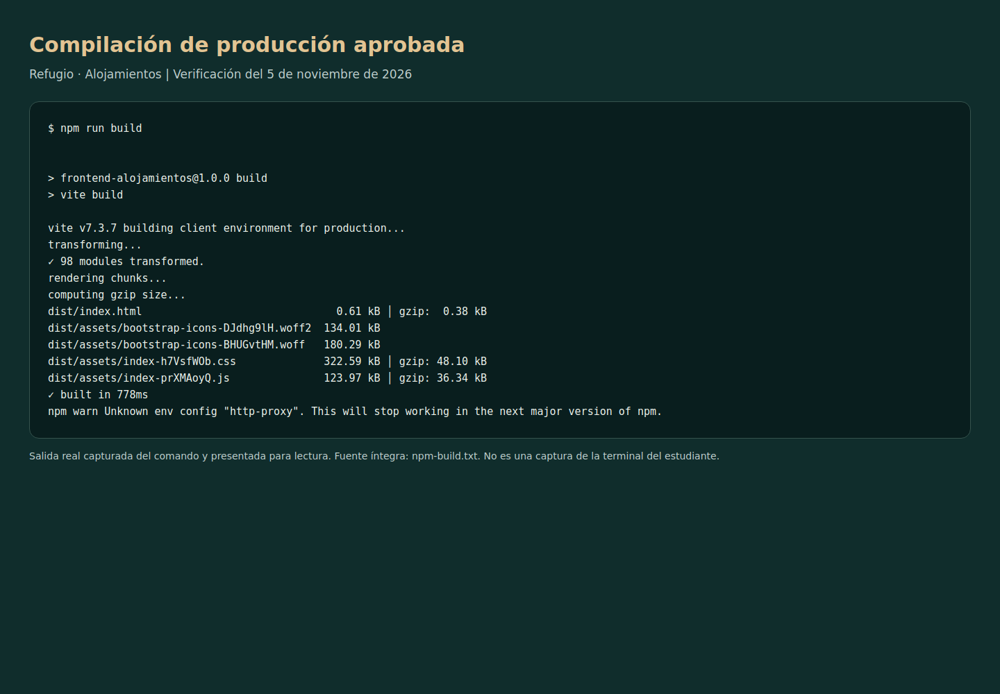

# Informe de verificación final

Fecha de ejecución: 5 de noviembre de 2026 (UTC). Preparación sobre una copia nueva del repositorio remoto, basada en el commit `40b3ee0` del Sprint 3.

## Qué se comprobó y qué falta

| Comprobación | Resultado | Evidencia |
| --- | --- | --- |
| Instalar dependencias | Correcto | [npm-install.txt](evidencias/npm-install.txt) |
| Pruebas frontend | 37 aprobadas, 0 fallidas | [Salida completa](evidencias/npm-test.txt) |
| Compilación Vite | Correcta, 98 módulos | [Salida completa](evidencias/npm-build.txt) |
| Servidor de desarrollo | SPA ejecutada con Flask real | Primera ejecución de integración en 5173 |
| Preview de producción | Flujo completo aprobado en 4173 | [Resultados de integración](evidencias/integracion.json) |
| Instalación independiente local | Dependencias instaladas desde cero; 37 pruebas y build correctos | [Registro](evidencias/instalacion-limpia.txt) |
| Pruebas backend | 16 aprobadas | [Salida pytest](evidencias/backend-pytest.txt) |
| Migraciones sobre MySQL | 001 → 002 → 003 | [Registro Alembic](evidencias/migraciones.txt) |
| Publicar cambios finales e integrar main | Pendiente de ejecutar con la cuenta del titular | [Pasos de publicación](entrega.md) |
| Clonar la versión FINAL desde GitHub | Pendiente después de publicar main | No se sustituye por la prueba local |
| XAMPP/MariaDB del equipo del estudiante | Repetir migraciones y comprobación local | [Configuración](backend.md) |

El aviso de npm sobre `http-proxy` pertenece a la configuración del entorno de verificación; los comandos terminaron con código 0. No es un error del proyecto ni una configuración incluida en los ZIP.

## Entorno y alcance de la evidencia

Frontend: v24.22.1 / npm 11.9.0, Vite 7.3.7, Bootstrap 5.3.8; navegador Chromium controlado con Playwright. Backend Flask con MySQL 8.0.36. Se usó una base aislada de verificación y cuentas con direcciones example.com. Las capturas corresponden a la aplicación real, no a maquetas; no se interceptó Fetch ni se reemplazó la API por datos simulados.

Las pruebas unitarias frontend sí sustituyen Fetch y sessionStorage con dobles de prueba para aislar contratos y estados; esto es independiente de la integración real. Las pruebas pytest usan la base SQLite temporal de su fixture. Por ese motivo se ejecutó además el flujo completo contra MySQL.

La última integración usa el build de una copia limpia independiente, servida con npm run preview. Las migraciones se aplicaron sobre una base vacía y se confirmó por SQL que alembic_version es 003, que el alojamiento eliminado ya no existe y que las dos comodidades del catálogo permanecen.

No se proporcionaron los archivos originales de pruebas del Tutorial 1/2/3. Se conservaron y ejecutaron las 37 pruebas del repositorio del estudiante: 9 de público, 14 de autenticación y 14 de gestión. Esto acredita esa suite, sin afirmar identidad textual con material del profesor que no se ha recibido.

## Matriz de integración funcional

| Área | Procedimiento comprobado | Resultado esperado observado |
| --- | --- | --- |
| Registro | Crear una cuenta desde el formulario | HTTP 201 y confirmación |
| Login y retorno | Abrir publicar como visitante e iniciar sesión | Regresa a /alojamientos/nuevo |
| Perfil | Consultar la identidad autenticada | Correo y datos recibidos por Bearer |
| Catálogo | Crear un alojamiento y consultar el listado | Aparece desde MySQL |
| Comodidades públicas | Abrir /comodidades | Catálogo recibido de MySQL |
| Estado de API | Abrir /estado-api | Conexión activa, servicio y versión |
| Filtro | Buscar por ciudad y por texto sin coincidencias | Resultado correcto y estado vacío |
| SPA | Abrir detalle, Atrás y Adelante | Conserva una marca en window: no recarga completa |
| Crear | Enviar título, descripción, ciudad y precio | Publicación visible en Mis alojamientos |
| Editar | Cambiar título y recargar | Persiste el cambio |
| Comodidades | Marcar Wifi, guardar y recargar | Asociación persistida |
| Retirar asociaciones | Desmarcar todas, guardar y recargar | Selección vacía persistida |
| Propiedad | Otra cuenta intenta PATCH, DELETE y asociación | Las tres peticiones devuelven 403 |
| Autorización | Usuario común intenta crear comodidad | 403; la sesión sigue válida |
| Administración | Admin consulta usuarios y modifica alojamiento ajeno | Respuestas correctas |
| Catálogo de comodidades | Admin crea y repite nombre | 201 y luego 409 |
| Validación del servidor | Campos vacíos y precio negativo | 400 |
| Eliminar | Primero cancelar; después confirmar | Cancelar conserva; confirmar devuelve 204; GET posterior 404 |
| JWT inválido | Corromper token y consultar perfil | 401, elimina sessionStorage y redirige a login |
| Cierre | Cerrar sesión y abrir perfil | Sin token, ruta privada redirige |
| Ruta desconocida | Abrir ruta inexistente | Página 404 con diseño de la aplicación |
| Responsive | 1440, 768 y 375 px | Sin desbordamiento horizontal en las vistas comprobadas |
| Menú móvil | Abrir menú y navegar | Se abre y la nueva vista vuelve a mostrarse con menú cerrado |

## Repetición manual en el equipo del estudiante

1. Iniciar MySQL, aplicar migraciones y dejar Flask ejecutándose.
2. Ejecutar npm run dev. Registrar dos usuarios distintos y promover una tercera cuenta a admin con el script local del backend.
3. Con el primer usuario publicar un alojamiento, anotar su id, modificarlo y asociar comodidades. Recargar cada vez para comprobar persistencia.
4. Con el segundo usuario abrir /alojamientos/ID/editar. Debe impedir la edición. Probar los endpoints también con ese token para confirmar que el servidor responde 403.
5. Con admin crear una comodidad, repetir su nombre para observar 409 y editar el alojamiento del primer usuario.
6. Cancelar la eliminación y comprobar que el alojamiento sigue existiendo; confirmar y comprobar que desaparece.
7. Cerrar sesión, intentar entrar a perfil y probar la navegación pública, Atrás/Adelante y el ancho móvil.
8. Ejecutar npm test y npm run build. Repetir desde el clon remoto nuevo después de publicar main.

Nunca adjuntar tokens, contraseñas ni el archivo .env a las evidencias.

## Ajustes realizados durante el cierre

- Límites de formulario alineados con el backend completado; precio representable en NUMERIC(12,2).
- Mensajes de validación de Flask interpretados desde detalles para mostrar errores útiles.
- Navbar sin la animación de cierre innecesaria que recortaba enlaces tras renderizar.
- Tarjetas con distribución flex para que el precio y el enlace de detalle queden visibles.
- Footer actualizado a la entrega del proyecto completo.
- .gitignore y documentación final, sin añadir funcionalidades ajenas al enunciado.

El backend remoto disponible aún no tenía CRUD; el complemento separado añade únicamente los endpoints requeridos y sus migraciones. No se debe presentar el frontend como integrado con el backend antiguo sin aplicar esa actualización.

## Salidas de pruebas y compilación

Estas imágenes presentan la salida real guardada en los archivos de texto, con un formato legible. No representan una sesión de terminal del equipo del estudiante.

